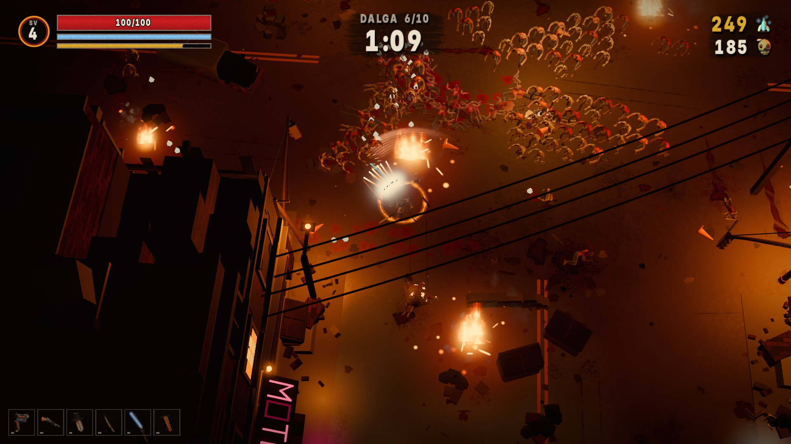
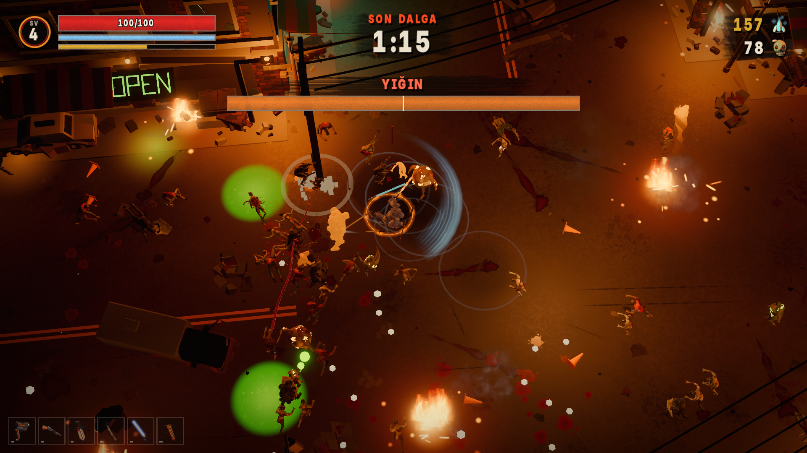
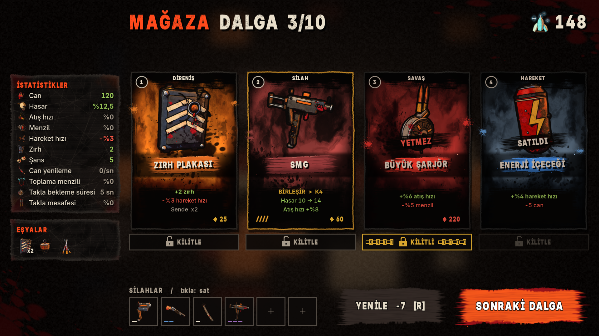
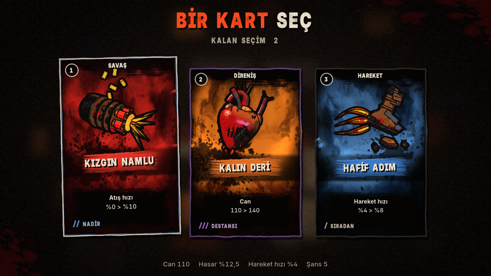
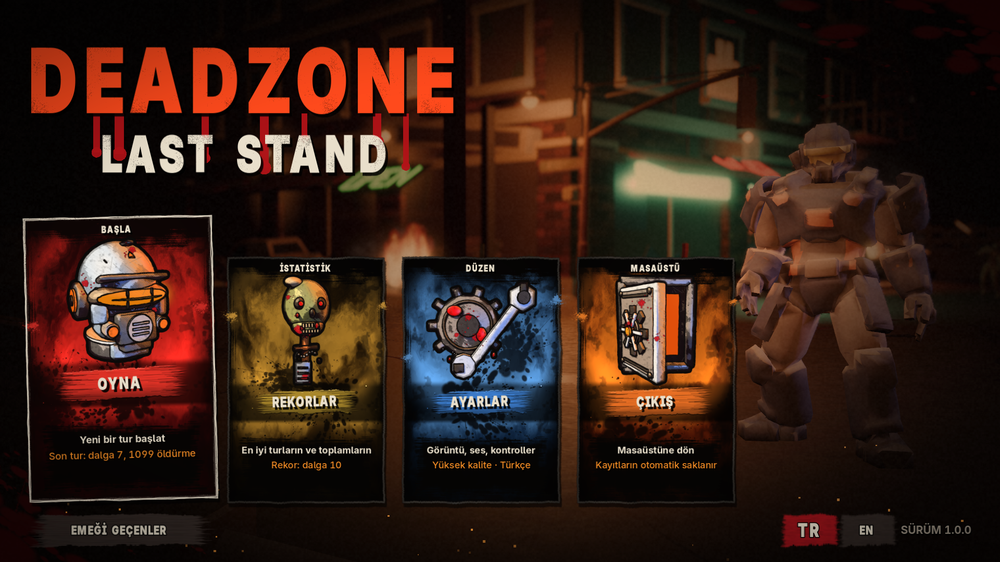

# Deadzone Last Stand

**Zırhlı bir asker, karanlık bir şehir kavşağı ve on dalga zombi sürüsü. Silahların kendi kendine ateş eder; sen hayatta kal.**

Deadzone Last Stand, Godot 4 ile yapılmış ücretsiz ve açık kaynak bir 3D dalga tabanlı hayatta kalma oyunu. Silahlar hedefini kendisi seçip ateş ediyor. Senin işin sürünün arasında yol bulmak, doğru anda takla atmak ve dalga aralarında kurulumunu güçlendirmek.

> *English:* Deadzone Last Stand is a free, open-source 3D wave survival game made with Godot 4. Your weapons aim and fire on their own; you move, dash and build your loadout between waves. Survive ten waves and the boss at the end. The game is available in Turkish and English.



| | |
|---|---|
|  |  |
|  |  |

**[⬇ Windows ve Linux için indir](https://github.com/AIVoidLabs/Deadzone-Last-Stand/releases/latest)** · **[🎮 itch.io sayfası](https://tahapek5454.itch.io/deadzone-last-stand)**


[](https://tahapek5454.itch.io/deadzone-last-stand)

---

## Nasıl oynanır

| Eylem | Tuş |
|---|---|
| Hareket | `W` `A` `S` `D` |
| Takla (kısa dokunulmazlık) | `Space` |
| Duraklat | `Esc` veya `P` |
| Tam ekran | `F11` veya `Alt` + `Enter` |
| Mağazada satın al | `1`–`4` |
| Mağazayı yenile | `R` |
| Menüler | Fare, ok tuşları + `Enter` / `Esc` |

Tuşlar ayarlardan değiştirilebilir. Nişan almazsın: silahlar en yakın zombiyi kendileri seçer.

**İpuçları**
- Takla seni kısa bir an dokunulmaz yapar, ama bekleme süresi uzun. Onu acil durumlar için sakla.
- Kristaller hem seviye hem para demek. Dalga bitince yerde kalan kristaller yeni dalgada kaybolur, o yüzden dalga sırasında topla.
- Aynı silahtan ikinci kez almak onu bir üst kademeye birleştirir. Mağaza kartı birleşmenin önce→sonra etkisini gösterir.
- Haritada süzülen çantalar ekstra para ya da XP verir; ekran dışındaysa kenardaki ok yerini gösterir.

## Özellikler

- **10 dalga ve boss:** her dalga yeni bir zombi türü getirir; son dalgada kusmuk yağdıran, zincirleme hücum eden boss gelir.
- **Kendine has zombiler:** koşan, zırhlı, sıçrayan, tükürücü, şişkin, tank, dilci, taş fırlatan ve çığlıkçı. Her birinin elle anahtarlanmış imza animasyonu var.
- **10 silah × 4 kademe:** tabanca, pompalı, SMG, plazma tüfeği, graviton topu, bomba atar, bıçak, katana, ateşli kılıç ve ışın kılıcı. Aynı anda 6 silah taşınır.
- **30 eşya ve seviye kartları:** her seviyede kart seçilir, dalga aralarında mağazadan eşya ve silah alınır. Silah, yakın dövüş ya da tank kurulumları kurulabilir.
- **Gece şehir atmosferi:** ıslak asfalt, ateşler, neon tabelalar, sis ve enkazla dolu bir kavşak.
- **Ses:** sürü inlemeleri, ortam sesleri, silah ve arayüz sesleri.
- **Ayarlar:** görüntü kipi ve çözünürlük, kalite profili (düşük / orta / yüksek), ses kanalları, tuş atama, Türkçe / İngilizce. Rekorlar ve ayarlar kaydedilir.

## İndir ve oyna

1. [itch.io sayfasından](https://tahapek5454.itch.io/deadzone-last-stand) ya da [GitHub'daki son sürümden](https://github.com/AIVoidLabs/Deadzone-Last-Stand/releases/latest) sistemine uygun dosyayı indir:
   - Windows: `DeadzoneLastStand-v1.0.0-windows.zip`
   - Linux: `DeadzoneLastStand-v1.0.0-linux.zip`
2. Zip'i bir klasöre çıkar ve oyunu çalıştır. Kurulum gerekmez.
   - Windows: `DeadzoneLastStand.exe`
   - Linux: `DeadzoneLastStand.x86_64` (gerekirse `chmod +x DeadzoneLastStand.x86_64`)
3. Windows "Bilgisayarınız korundu" uyarısı gösterirse **Ek bilgi → Yine de çalıştır**'a tıkla. Exe imzasız olduğu için bu uyarı çıkıyor.

**Sistem gereksinimi:** 64 bit Windows 10/11 ya da Linux, Vulkan destekli bir ekran kartı.

## Kaynaktan çalıştır

1. [Godot 4.7](https://godotengine.org/download)'yi indir. **Standard** sürüm yeterli, .NET sürümü gerekmez.
2. Depoyu klonla:
   ```bash
   git clone https://github.com/AIVoidLabs/Deadzone-Last-Stand.git
   ```
3. Godot'da **Import** ile `project.godot` dosyasını aç, sonra `F5` ile çalıştır.

Editörde ve debug yapılarda geliştirici tuşları da açıktır: `F3` debug paneli, `F4` +50 zombi, `F5` ölümsüzlük, `F6` kalite profili, `F7` silah ekle, `F8` dalgayı bitir, `F9` seviye atla. Yayın (release) sürümünde bu tuşlar yoktur.

### Testler

Saf oyun kuralları (hasar, silah birleştirme, mağaza, dalga üretimi, kart seçimi…) [GUT](https://github.com/bitwes/Gut) ile test ediliyor:

```bash
godot --headless --path . -s res://addons/gut/gut_cmdln.gd
```

Sonda `All tests passed` görünmeli.

## Proje yapısı

```
scenes/    sahneler (main.tscn, ana menü, oyuncu, zombiler, silahlar, dünya, arayüz)
scripts/   tuning.gd (tüm oynanış sayıları), autoload/, game/ (saf kurallar),
           data/ (silah, eşya, zombi ve dalga tabloları), player/, enemies/, weapons/, world/, ui/, fx/
assets/    modeller, shader'lar, sesler, dokular, yazı tipi
tests/     GUT testleri
tools/     Blender betikleri (tools/blender), ses işleme ve sentez (tools/sfx), Godot araçları (tools/godot)
docs/      tasarım belgesi, kararlar ve geliştirme günlüğü
```

Birkaç tasarım kararı:
- **Fizik ve görüntü ayrı.** Asker ve zombilerde hareket kodu yalnız durum sinyalleri yayınlar; model, animasyon ve efektler görüntü katmanında bu sinyalleri dinler.
- **İçerik veri tablosu.** Silahlar, eşyalar, zombi türleri ve dalgalar `scripts/data/` altında tablo; yeni içerik bir satır eklemek demek.
- **Sihirli sayı yok.** Bütün oynanış değerleri `scripts/tuning.gd`'de; her özellik tek bir `FEATURE_*` sabitiyle kapatılabilir.
- **Sürü bütçesi.** Zombiler, mermiler ve efektler havuzdan gelir; yol bulma yok, basit yönelme ve birbirini itme var.
- **Modeller betikle.** Zombiler Blender'da `tools/blender/` betikleriyle üretildi ve yeniden üretilebilir.

## Krediler ve lisans

Kod [MIT lisansı](LICENSE) ile dağıtılıyor. Asker modeli [Tripo](https://www.tripo3d.ai) ile üretildi. Animasyon kütüphanesi, model paketleri, ses dosyaları ve yazı tipinin kaynakları ve lisansları [`CREDITS.md`](CREDITS.md)'de.

Yapan: **Taha Pek** · [github.com/tahapek5454](https://github.com/tahapek5454)
